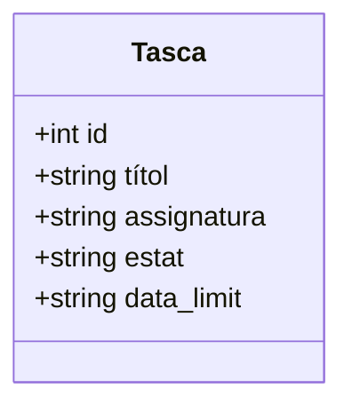

# SPECIFICATIONS.md — Sistema Tasks_app (v2.0)

## 1. Visió General
Tasks_app és una eina CLI lleugera per ajudar als estudiants a gestionar les seves tasques acadèmiques diàries.

## 2. User Stories (Històries d'Usuari)

### Iteració 1 (v1.0)
- US-01: Com a estudiant, vull afegir una tasca amb títol i assignatura per recordar els meus deures.
- US-02: Com a estudiant, vull veure la llista de tasques pendents per organitzar el meu temps.

### Iteració 2 (v2.0)
- US-03: Com a estudiant, vull indicar una data límit en donar d'alta una tasca per tal de saber fins quan l'he de lliurar.
- US-04: Com a estudiant, vull modificar qualsevol atribut d'una tasca a partir del seu ID per tal de corregir els errors comesos en registrar-la.
- US-05: Com a estudiant, vull marcar una tasca com a completada per tal de distingir el que ja he fet del que em queda pendent.
- US-06: Com a estudiant, vull que el llistat m'avisi de les tasques caducades i urgents per tal de prioritzar el meu treball.

## 3. Model de Dades (Mermaid)

- `estat` pot valer `pendent` (per defecte) o `completada`.
- `data_limit` és opcional (v2.0). Format `AAAA-MM-DD`. Les tasques sense data límit s'emmagatzemen amb `data_limit: null`. Els registres de la v1.0 que no tenen el camp es consideren sense data límit.

## 4. Requisits

### Iteració 1 (v1.0)
- RF-01 : El sistema tasks_app ha de guardar les tasques en un fitxer JSON de persistència local.
- RF-02 : Si el fitxer `data/tasks.json` no existeix, el sistema tasks_app ha de crear `data/tasks.json`  inicialitzat amb una llista JSON buida ([])
- RF-03 : El sistema tasks_app ha de proveir a l'estudiant la capacitat de crear una nova tasca amb estat 'pendent' mitjançant el comandament add --title <títol> --subject <assignatura>.
- RF-04: El sistema tasks_app ha de proveir a l’estudiant la capacitat de visualitzar totes les tasques registrades (incloent-hi el seu ID, títol, assignatura i estat) mitjançant el comandament list.

### Iteració 2 (v2.0)
- RF-05 : El sistema tasks_app ha de proveir a l'estudiant la capacitat de indicar, de manera opcional, la data límit d'una nova tasca mitjançant l'opció `--due AAAA-MM-DD` del comandament add.
- RF-06 : Si la data indicada amb `--due` no és una data vàlida en format `AAAA-MM-DD`, el sistema tasks_app ha de mostrar el missatge `Error: data límit no vàlida (format esperat: AAAA-MM-DD)` i no ha de registrar cap canvi a `data/tasks.json`.
- RF-07 : El sistema tasks_app ha de proveir a l'estudiant la capacitat de modificar els atributs títol, assignatura, data límit i estat d'una tasca existent mitjançant el comandament `edit --id <ID>` acompanyat d'una o més de les opcions `--title <títol>`, `--subject <assignatura>`, `--due AAAA-MM-DD` i `--status <estat>`.
- RF-08 : Si el valor de l'opció `--status` no és `pendent` ni `completada`, el sistema tasks_app ha de mostrar el missatge `Error: estat no vàlid (valors permesos: pendent, completada)` i no ha de registrar cap canvi a `data/tasks.json`.
- RF-09 : Si l'ID indicat als comandaments `edit` o `done` no correspon a cap tasca registrada, el sistema tasks_app ha de mostrar el missatge `Error: no existeix cap tasca amb ID <ID>` i no ha de registrar cap canvi a `data/tasks.json`.
- RF-10 : El sistema tasks_app ha de proveir a l'estudiant la capacitat de marcar una tasca com a completada mitjançant el comandament `done --id <ID>`, de manera que l'estat de la tasca passi a `completada`.
- RF-11 : El sistema tasks_app ha de mostrar, en el comandament list, la data límit de les tasques que en tenen, amb el format ` - límit: AAAA-MM-DD` a continuació de l'estat.
- RF-12 : Si una tasca amb estat `pendent` té una data límit anterior a la data actual, el sistema tasks_app ha de mostrar l'indicador `[CADUCADA]` al final de la seva línia en el comandament list.
- RF-13 : Si una tasca amb estat `pendent` té una data límit igual o posterior a la data actual i inferior a 7 dies respecte d'aquesta (és a dir, entre 0 i 6 dies), el sistema tasks_app ha de mostrar l'indicador `[URGENT]` al final de la seva línia en el comandament list.
- RF-14 : El sistema tasks_app no ha de mostrar mai els indicadors `[CADUCADA]` ni `[URGENT]` per a tasques amb estat `completada` ni per a tasques sense data límit.

### Requisits no funcionals (v2.0)
- RNF-01 : El sistema tasks_app ha d'obtenir la data actual de la variable d'entorn `TASKS_AVUI` (format `AAAA-MM-DD`) quan estigui definida, i del rellotge del sistema en cas contrari, per tal de poder verificar els escenaris dependents de la data.

## 5. Criteris d’acceptació i proves (Gherkin scenarios)

### Iteració 1 (v1.0)
- GS-01: Creació correcta d'una tasca
  Atès que la base de dades JSON no conté encara tasques
  quan l’estudiant executa `python src/tasks_app.py add --title 'Pràctica 1' --subject 'RS'`
  aleshores el sistema confirma `Tasca [ID: 1] creada amb èxit`
  i la tasca queda registrada al fitxer `data/tasks.json`.

- GS-02: Llistat de tasques quan `data/tasks.json` no conté registres 
  Atès que la base de dades JSON no conté encara tasques
  quan l’estudiant executa `python src/tasks_app.py list`
  aleshores el sistema mostra `Registre de tasques buit.` 

- GS-03: Llistat de tasques quan data/tasks.json conté registres
  Atès que el fitxer `data/tasks.json` conté les següents tasques:
    | id | títol          | assignatura | estat   |
    | 1  | Pràctica 1     | RS          | pendent |
    | 2  | Examen parcial | SO          | pendent |
  quan l’estudiant executa `python src/tasks_app.py list`
  aleshores el sistema mostra per pantalla:
    "[1] Pràctica 1 (RS) - estat: pendent"
    "[2] Examen parcial (SO) - estat: pendent"

- GS-04: Creació del fitxer de dades quan no existeix
  Atès que el fitxer `data/tasks.json` no existeix
  quan l’estudiant executa `python src/tasks_app.py list`
  aleshores el sistema crea el fitxer `data/tasks.json` inicialitzat amb una llista JSON buida (`[]`)
  i el sistema mostra `Registre de tasques buit.`

- GS-05: Assignació d'identificadors consecutius
  Atès que el fitxer `data/tasks.json` conté les següents tasques:
    | id | títol          | assignatura | estat   |
    | 1  | Pràctica 1     | RS          | pendent |
    | 2  | Examen parcial | SO          | pendent |
  quan l’estudiant executa `python src/tasks_app.py add --title 'Lliurament P5' --subject 'RS'`
  aleshores el sistema confirma `Tasca [ID: 3] creada amb èxit`
  i el fitxer `data/tasks.json` conté 3 tasques
  i la tasca amb id 3 té títol `Lliurament P5`, assignatura `RS` i estat `pendent`.

### Iteració 2 (v2.0)
Nota: en els escenaris GS-13 a GS-17 la data actual és `2026-11-24` (`TASKS_AVUI=2026-11-24`, RNF-01).

- GS-06: Creació d'una tasca amb data límit (RF-05)
  Atès que la base de dades JSON no conté encara tasques
  quan l’estudiant executa `python src/tasks_app.py add --title 'Pràctica 5' --subject 'RS' --due 2026-12-15`
  aleshores el sistema confirma `Tasca [ID: 1] creada amb èxit`
  i la tasca amb id 1 queda registrada a `data/tasks.json` amb `data_limit` igual a `2026-12-15`.

- GS-07: Creació d'una tasca amb data límit no vàlida (RF-06)
  Atès que la base de dades JSON no conté encara tasques
  quan l’estudiant executa `python src/tasks_app.py add --title 'Pràctica 5' --subject 'RS' --due 2026-13-45`
  aleshores el sistema mostra `Error: data límit no vàlida (format esperat: AAAA-MM-DD)`
  i el fitxer `data/tasks.json` continua sense contenir tasques.

- GS-08: Modificació d'atributs d'una tasca (RF-07)
  Atès que el fitxer `data/tasks.json` conté les següents tasques:
    | id | títol      | assignatura | estat   | data_limit |
    | 1  | Practica 1 | SO          | pendent | null       |
  quan l’estudiant executa `python src/tasks_app.py edit --id 1 --title 'Pràctica 1' --subject 'RS' --due 2026-12-01`
  aleshores el sistema confirma `Tasca [ID: 1] modificada amb èxit`
  i la tasca amb id 1 té títol `Pràctica 1`, assignatura `RS`, estat `pendent` i data límit `2026-12-01`.

- GS-09: Modificació d'una tasca amb estat no vàlid (RF-08)
  Atès que el fitxer `data/tasks.json` conté la tasca amb id 1, títol `Pràctica 1`, assignatura `RS` i estat `pendent`
  quan l’estudiant executa `python src/tasks_app.py edit --id 1 --status acabada`
  aleshores el sistema mostra `Error: estat no vàlid (valors permesos: pendent, completada)`
  i la tasca amb id 1 continua amb estat `pendent`.

- GS-10: Modificació d'una tasca inexistent (RF-09)
  Atès que el fitxer `data/tasks.json` conté només la tasca amb id 1
  quan l’estudiant executa `python src/tasks_app.py edit --id 99 --title 'Nou títol'`
  aleshores el sistema mostra `Error: no existeix cap tasca amb ID 99`
  i el fitxer `data/tasks.json` no canvia.

- GS-11: Marcar una tasca com a completada (RF-10)
  Atès que el fitxer `data/tasks.json` conté la tasca amb id 1, títol `Pràctica 1`, assignatura `RS` i estat `pendent`
  quan l’estudiant executa `python src/tasks_app.py done --id 1`
  aleshores el sistema confirma `Tasca [ID: 1] completada`
  i la tasca amb id 1 té estat `completada`.

- GS-12: Marcar com a completada una tasca inexistent (RF-09)
  Atès que el fitxer `data/tasks.json` no conté cap tasca amb id 99
  quan l’estudiant executa `python src/tasks_app.py done --id 99`
  aleshores el sistema mostra `Error: no existeix cap tasca amb ID 99`
  i el fitxer `data/tasks.json` no canvia.

- GS-13: Llistat d'una tasca amb data límit llunyana (RF-11)
  Atès que el fitxer `data/tasks.json` conté la tasca amb id 1, títol `Pràctica 5`, assignatura `RS`, estat `pendent` i data límit `2026-12-15`
  quan l’estudiant executa `python src/tasks_app.py list`
  aleshores el sistema mostra per pantalla:
    "[1] Pràctica 5 (RS) - estat: pendent - límit: 2026-12-15"
  i la línia no conté cap indicador `[CADUCADA]` ni `[URGENT]`.

- GS-14: Llistat d'una tasca caducada (RF-12)
  Atès que el fitxer `data/tasks.json` conté la tasca amb id 1, títol `Pràctica 1`, assignatura `RS`, estat `pendent` i data límit `2026-11-20`
  quan l’estudiant executa `python src/tasks_app.py list`
  aleshores el sistema mostra per pantalla:
    "[1] Pràctica 1 (RS) - estat: pendent - límit: 2026-11-20 [CADUCADA]"

- GS-15: Llistat d'una tasca urgent (RF-13)
  Atès que el fitxer `data/tasks.json` conté la tasca amb id 1, títol `Examen parcial`, assignatura `SO`, estat `pendent` i data límit `2026-11-27`
  quan l’estudiant executa `python src/tasks_app.py list`
  aleshores el sistema mostra per pantalla:
    "[1] Examen parcial (SO) - estat: pendent - límit: 2026-11-27 [URGENT]"

- GS-16: Límits del període d'urgència (RF-12, RF-13)
  Atès que el fitxer `data/tasks.json` conté les següents tasques pendents:
    | id | títol | assignatura | data_limit |
    | 1  | A     | RS          | 2026-11-24 |
    | 2  | B     | RS          | 2026-11-30 |
    | 3  | C     | RS          | 2026-12-01 |
  quan l’estudiant executa `python src/tasks_app.py list`
  aleshores la tasca 1 (venç avui) mostra `[URGENT]` i no `[CADUCADA]`
  i la tasca 2 (venç d'aquí a 6 dies) mostra `[URGENT]`
  i la tasca 3 (venç d'aquí a 7 dies) no mostra cap indicador.

- GS-17: Les tasques completades i les tasques sense data límit no mostren indicadors (RF-14)
  Atès que el fitxer `data/tasks.json` conté les següents tasques:
    | id | títol | assignatura | estat      | data_limit |
    | 1  | A     | RS          | completada | 2026-11-20 |
    | 2  | B     | RS          | pendent    | null       |
  quan l’estudiant executa `python src/tasks_app.py list`
  aleshores el sistema mostra per pantalla:
    "[1] A (RS) - estat: completada - límit: 2026-11-20"
    "[2] B (RS) - estat: pendent"

## 6. Històric de versions
| Versió | Iteració | Contingut incorporat |
|--------|----------|----------------------|
| v1.0   | 1        | US-01, US-02. RF-01 a RF-04. GS-01 a GS-05. Afegir i llistar tasques en JSON. |
| v2.0   | 2        | US-03 a US-06. RF-05 a RF-14, RNF-01. GS-06 a GS-17. Data límit, edició, completar tasca i indicadors `[CADUCADA]` / `[URGENT]`. |

## 7. Traçabilitat requisits → escenaris
| Requisit | Escenaris |
|----------|-----------|
| RF-05 | GS-06 |
| RF-06 | GS-07 |
| RF-07 | GS-08 |
| RF-08 | GS-09 |
| RF-09 | GS-10, GS-12 |
| RF-10 | GS-11 |
| RF-11 | GS-13 |
| RF-12 | GS-14, GS-16 |
| RF-13 | GS-15, GS-16 |
| RF-14 | GS-17 |
| RNF-01 | GS-13 a GS-17 |
